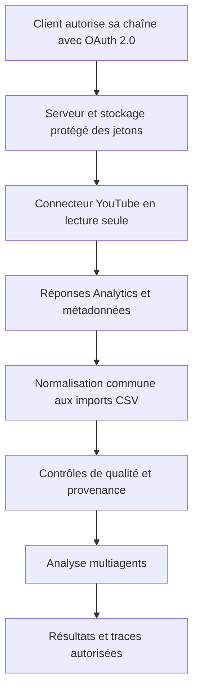
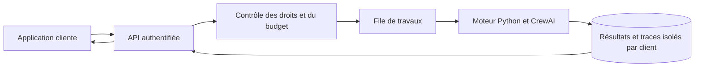

# Annexe sur une future version avec API

## Objet et statut

Cette annexe étudie deux évolutions possibles si un client les demande : automatiser la collecte YouTube et exposer le moteur d’analyse à une application cliente. **Aucune de ces API n’est développée ni connectée à ce stade.** La version du cours reste locale et alimentée par CSV.

Les possibilités techniques sont fondées sur les documentations officielles consultées le **15 octobre 2026**. Les permissions, quotas, conditions et prix seront revérifiés avant une réalisation commerciale. Aucun délai ni prix de vente n’est garanti dans cette annexe.

## Valeur pour le client

Client visé : créateur, petite agence ou équipe éditoriale souhaitant consolider ses statistiques et obtenir des recommandations traçables. Décision visée : déterminer quels contenus ou formats tester ensuite.

La valeur devra être mesurée par le temps consacré à la préparation des analyses, la fraîcheur des données, le taux d’analyses exploitables et le coût par analyse. Un abonnement ou une facturation à l’analyse restent des hypothèses à tester avec un client ; l’amélioration de l’audience ne peut pas être promise.

## Collecte automatique YouTube

YouTube Analytics permet des requêtes statistiques ciblées ; YouTube Reporting permet des rapports en volume. YouTube Data API sert notamment à récupérer les métadonnées des ressources. Le premier connecteur proposé utilisera Analytics pour les statistiques et Data API pour les métadonnées nécessaires, après validation des champs disponibles.

Sources : [présentation Analytics et Reporting](https://developers.google.com/youtube/analytics), [YouTube Data API](https://developers.google.com/youtube/v3/getting-started).

Les rapports Analytics nécessitent une autorisation OAuth 2.0. Une simple clé API ne donne pas accès aux statistiques privées d’une chaîne. Les portées exactes seront déterminées avec les endpoints retenus et la documentation d’autorisation alors applicable ; aucune permission d’écriture ou de monétisation n’est prévue par défaut.

Source : [référence reports.query et autorisations](https://developers.google.com/youtube/analytics/reference/reports/query).

Une preuve de faisabilité devra confirmer, sur une chaîne autorisée, les combinaisons de dimensions et métriques nécessaires : période, vidéo et pays selon les rapports compatibles. La disponibilité d’une colonne dans Studio ne garantit pas une correspondance identique dans un endpoint API. La date de fin réellement disponible sera enregistrée, car les données peuvent être moins récentes que la date demandée.

La synchronisation conservera la période, le moment de collecte et les clés d’agrégation. Elle évitera les doublons et permettra de reprendre une collecte interrompue. En cas de quota atteint ou de consentement révoqué, conserver les données déjà acquises, afficher leur fraîcheur et proposer l’import CSV.

## API d’analyse destinée au client

Le moteur Python sera séparé de Streamlit. Une couche HTTP, proposée avec FastAPI, pourra réutiliser les mêmes calculs, agents et règles de validation sans imposer un changement vers LangGraph ou React.

Contrat proposé pour une première version, à valider avec le client :

| Route proposée | Fonction |
|---|---|
| POST /v1/datasets | Importer un jeu de données autorisé ; retourner son identifiant et ses avertissements |
| POST /v1/analyses | Soumettre dataset_id, scénario et question ; retourner un identifiant de travail avec HTTP 202 |
| GET /v1/analyses/{id} | Consulter état, résultat, validation et métriques autorisées |
| GET /v1/analyses/{id}/events | Obtenir les événements résumés pour suivi ou relecture |

Les analyses seront asynchrones. Les requêtes de création accepteront une clé d’idempotence pour éviter de facturer deux fois un travail après une reprise réseau. Les états publics seront queued, running, succeeded, failed et cancelled ; les erreurs retourneront un code stable et une explication sans secret. Les coûts inconnus ne seront pas présentés comme nuls.

## Hébergement et protection des données

La version commerciale nécessitera TLS, authentification, autorisation par client, contrôle des volumes, journalisation expurgée et gestion des secrets côté serveur. Les jetons YouTube devront être protégés au repos, révocables et exclus des traces. Aucune donnée d’un client ne devra être accessible avec l’identifiant d’analyse d’un autre.

Une file de travaux et une base adaptée à la concurrence, par exemple PostgreSQL, remplaceront le stockage local si plusieurs clients exécutent des analyses simultanément. La durée de conservation, la suppression des données, les sauvegardes et les fournisseurs autorisés seront convenus avant déploiement.

AgentOps peut capturer des prompts et résultats : l’instrumentation devra être contrôlée et limitée aux données autorisées. Le périmètre transmis au fournisseur IA et à l’observabilité devra être explicite ; seules les données agrégées approuvées quitteront l’environnement du client.

## Coûts et conditions de décision

Le chiffrage devra séparer hébergement, stockage, appels IA, observabilité, maintenance et intégration. Les quotas API sont des limites de capacité ; ils ne doivent pas être confondus avec un tarif commercial. Aucun montant n’est fixé sans profil d’usage et vérification des conditions des fournisseurs.

La décision de réaliser cette version dépend de six validations : autorisation effective d’une chaîne, disponibilité des métriques nécessaires, intérêt confirmé du client, coût mesuré par analyse, budget d’exploitation accepté et tests d’isolation réussis. L’éventuelle vérification de l’application OAuth devra être examinée selon les portées et le mode de distribution retenus.

## Tests avant mise en service

- Comparer un rapport API et un export Studio sur une même période et des métriques compatibles ; expliquer les écarts.
- Tester expiration et révocation des jetons, quota, erreur fournisseur et reprise sans doublon.
- Refuser un accès aux données d’un autre client et tout import non autorisé.
- Vérifier idempotence, états asynchrones, arrêt au budget et données partielles.
- Tester restauration des sauvegardes, suppression des données et absence de secrets dans les journaux.

## Conclusion de faisabilité

L’évolution est techniquement plausible et peut réutiliser le socle Python. Sa faisabilité pour un client précis reste à démontrer par un connecteur autorisé et une analyse de bout en bout mesurée. Le prototype du cours fournit le moteur et les preuves expérimentales ; il ne constitue pas encore un service commercial exploitable.
