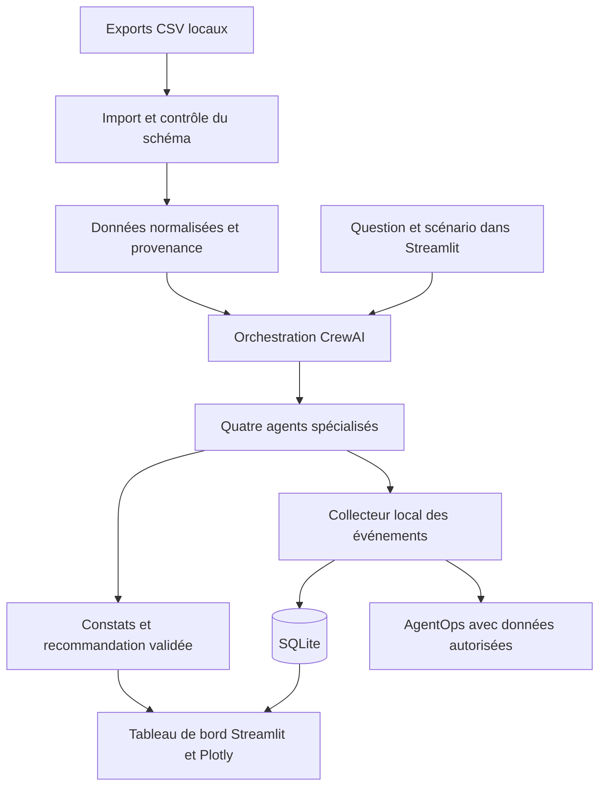
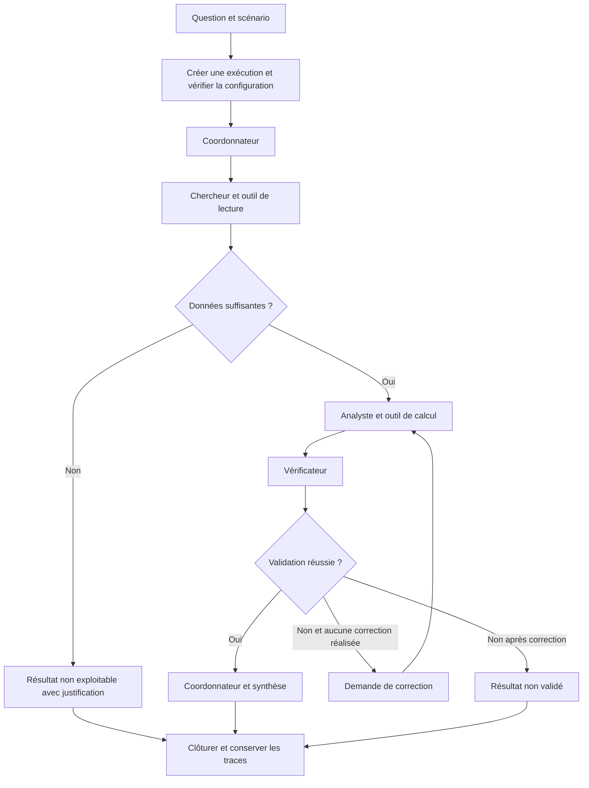

# Architecture de l’observatoire

## Mission et périmètre

Recevoir une question éditoriale, analyser des données YouTube et produire des constats vérifiés avec leurs limites. L’utilisateur doit comprendre à la fois la performance du contenu et celle du système qui réalise l’analyse.

La première version fonctionne localement sous Windows, en français, à partir d’exports CSV. Les calculs sont déterministes ; les agents organisent le travail, interprètent les résultats et vérifient leurs preuves. L’application ne publie aucune vidéo et ne modifie pas le compte YouTube.

## Architecture générale

SQLite est la source du tableau de bord. L’instrumentation AgentOps sera validée sur un petit essai réel : champs capturés, association aux identifiants locaux et absence de données sensibles. Une indisponibilité d’AgentOps sera signalée et ne devra pas supprimer les traces locales.

## Agents et outils

| Agent | Objectif et tâche | Interaction et sortie |
|---|---|---|
| Coordonnateur | Comprendre la demande, définir le périmètre et distribuer les tâches | Transmet une mission au chercheur et prépare la réponse finale à partir de la validation |
| Chercheur | Sélectionner les données utiles et contrôler leur disponibilité | Transmet à l’analyste un inventaire des données et des limites |
| Analyste | Appeler les calculs et produire des constats quantifiés | Transmet ses constats et leurs preuves au vérificateur |
| Vérificateur | Contrôler les mesures, comparaisons et recommandations | Retourne un résultat validé ou une demande de correction précise |

Les rôles, objectifs, instructions, tâches et formats de sortie seront définis explicitement dans la configuration des agents. Une classe ou un nom d’agent sans intervention réelle ne satisfait pas l’exigence.

Deux outils métier seront exposés à CrewAI et leurs appels seront tracés :

1. **Lecture des données** : lire les exports autorisés, sélectionner les lignes et retourner des données structurées avec provenance et avertissements.
2. **Calcul des indicateurs** : agréger, comparer et classer avec Python/pandas ; retourner valeurs, unités, dénominateurs et références des groupes analysés.

Les outils ne donnent pas un accès arbitraire au système de fichiers. Les agents n’inventent pas de statistiques absentes et ne recalculent pas les totaux par génération de texte.

## Déroulement d’une exécution

Une seule boucle de correction est autorisée. Les reprises techniques d’appels transitoires sont comptées séparément, limitées et configurées. Aucun nouvel appel ne démarre après atteinte du budget ; les appels déjà en cours peuvent toutefois générer des frais. Le fournisseur, le modèle et les plafonds devront être fixés avant la campagne réelle.

## Interfaces internes et stockage

La logique métier sera indépendante de Streamlit afin de pouvoir être réutilisée dans l’API future. Organisation prévue : modules pour agents, outils, données, traces, calculs et vues ; dossier de tests et documentation séparés.

| Entité | Informations essentielles |
|---|---|
| Jeu de données | Identifiant, empreinte du fichier, schéma, période, origine réelle ou fictive, avertissements |
| Exécution | Identifiant, scénario, question, jeu de données, configuration, début, fin, état et résultat |
| Étape ou tentative | Agent, tâche, modèle, état, horaires, durée, jetons, coût, outils, erreur et numéro de tentative |
| Événement | Ordre, horodatage, exécution, étape, type, émetteur, destinataire et résumé autorisé |
| Validation | Critères contrôlés, preuves, score, limites et décision |

Les sorties des agents suivent un schéma structuré validé : constats, preuves calculées, limites et recommandations. La liaison des événements utilise des identifiants stables ; la relecture ne relance aucun appel IA. Aucun raisonnement interne détaillé n’est collecté.

## Vues et interactions

| Visualisation obligatoire | Données et lecture attendue |
|---|---|
| Graphe interactif Plotly | Agents et communications ; état et agent actif à l’étape sélectionnée |
| Timeline ou cascade | Début, fin et durée des actions, tentatives et outils |
| Sankey | Nombre de messages par relation entre agents ; unité explicite |
| Graphique comparatif | Durée, jetons, coût estimé ou qualité par agent et configuration |
| Carte thermique | Taux d’erreur par agent et scénario avec effectifs |
| Indicateurs clés | Nombre d’exécutions, réussite, durée moyenne, jetons, coût, erreurs, agent le plus sollicité et le plus lent |

Le graphe offre survol, sélection et navigation dans les étapes. Trois filtres indépendants — agent, scénario, état — actualisent les vues concernées ; sélection d’exécution, comparaison de deux exécutions et relecture complètent l’interface. Une sélection vide affiche un message explicite.

Les statistiques éditoriales sont présentées séparément des performances techniques. Chaque graphique possède titre, unités adaptées, légende si nécessaire et interprétation appuyée par les données.

## Références officielles

- [CrewAI](https://docs.crewai.com)
- [AgentOps](https://docs.agentops.ai)
- [Streamlit](https://docs.streamlit.io)
- [Plotly Python](https://plotly.com/python/)

L’autre architecture de l’énoncé associe [LangGraph](https://docs.langchain.com/oss/python/langgraph), [Langfuse](https://langfuse.com/docs), [React Flow](https://reactflow.dev) et [Apache ECharts](https://echarts.apache.org). Elle n’est pas requise pour ajouter une API au socle Python.
